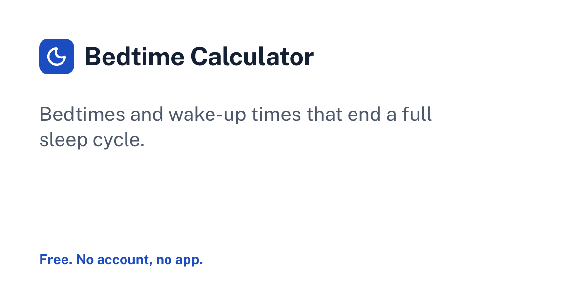

# Bedtime Calculator

A free sleep cycle calculator: find a bedtime or a wake-up time that ends a full sleep cycle, plus a nap calculator.



## What it does

- **Wake up at / go to bed at:** pick a time and get the best options for 3 to 6 sleep cycles, with the ones most adults need highlighted and a line on who each option suits.
- **Fine-tune:** set your own minutes to fall asleep and cycle length; the settings are remembered on your device.
- **Reminders:** add any time to your calendar as an `.ics` file made in the browser, or as a Google Calendar event.
- **Nap calculator:** a 20 minute power nap or a 90 minute full-cycle nap, from now or from any time.
- **Shareable answers:** the URL keeps the mode and the time.
- **Sources:** the recommendations come from the CDC and the American Academy of Sleep Medicine, cited on the page.

## Data

The time math lives in `src/components/sleep/sleep-math.ts`, with a self-check: `node --experimental-strip-types src/components/sleep/sleep-math.check.ts`.

## Quality bar

- WCAG 2.1 AA: contrast checked on every color pair in light and dark mode, visible focus, labeled inputs, 44px touch targets and reduced motion
- Responsive from 320px to wide desktop with no sideways scrolling
- Every state is designed: empty, loading, zero results, errors, and no JavaScript
- SEO: semantic headings, canonical URLs, structured data, a sitemap and Open Graph images

## Stack

- [Astro 7](https://astro.build) with static output, plain TypeScript and plain CSS (no UI framework)
- One design system: tokens in `src/styles/tokens.css`, a component kit in `src/components/ui/`, and Public Sans served through Astro's Fonts API
- Inline SVG icons from [Lucide](https://lucide.dev) (ISC)
- No tracking and no accounts; anything saved stays in the visitor's browser

## Run it

```bash
pnpm install
pnpm dev          # http://localhost:4321
pnpm astro check  # types
pnpm build        # static site in dist/
```

## Status

A working prototype. Before a public launch, fill in the fields marked `OWNER TO FILL` in `src/site.ts` (name, domain, contact and host), then set `prototypeNotices` to `false`. The build fails while a required field is empty.
